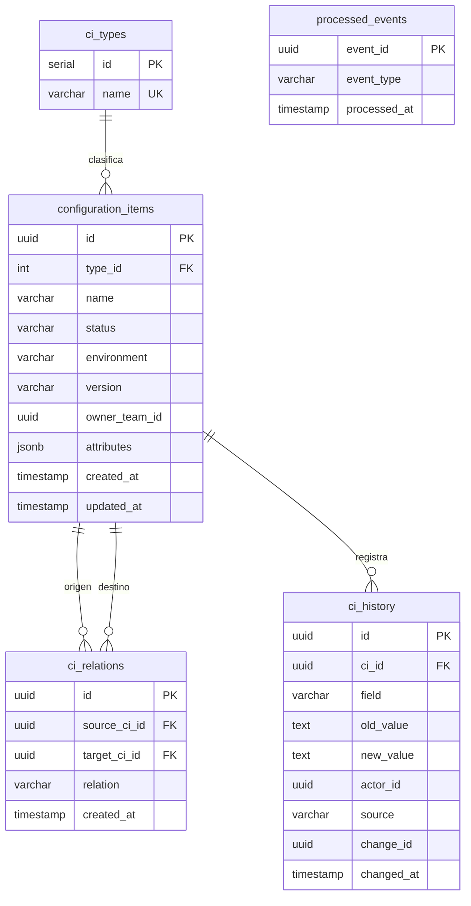

# ms-cmdb — ServiDesk

Elementos de configuración (CI), tipos, relaciones e historial de cambios.
Contrato: `docs/API_CONTRACTS.md` §8.2.

## Endpoints

| ID | Método y ruta | Roles | Handler |
|---|---|---|---|
| CM-01 | `GET /cis` | admin, agent | `cis.listCis` — filtros `status`, `environment` (varios con coma), `type_id`, `owner_team_id`, `search` (nombre); orden `created_at`, `updated_at`, `name`, `status` |
| CM-02 | `POST /cis` | admin, agent | `cis.createCi` — nace `operational`; `attributes` objeto JSON ≤ 8 KB |
| CM-03 | `GET /cis/{id}` | admin, agent | `cis.getCi` |
| CM-04 | `PATCH /cis/{id}` | admin, agent | `cis.updateCi` — solo los campos que cambian; cada uno queda en `ci_history`; `retired` → 409 |
| CM-05 | `PUT /cis/{id}/status` | admin, agent | `cis.changeCiStatus` — publica `CIStatusChanged`; mismo estado o `retired` → 409 |
| CM-06 | `DELETE /cis/{id}` | admin | `cis.deleteCi` — baja lógica a `retired`, 204 idempotente, publica `CIStatusChanged` |
| CM-07 | `GET /cis/{id}/relations` | admin, agent | `cis.listCiRelations` — `direction` `outgoing` / `incoming` |
| CM-08 | `GET /ci-types` | admin, agent | `cis.listCiTypes` |

## Eventos

- **Publica** `CIStatusChanged {ciId, name, previousStatus, status, actorId}` después del COMMIT.
  Si `status = down`, ms-incidents (`incidents-ci-q`) abre un incidente P2 automático.
- **Consume** `cmdb-changes-q` ← `ChangeImplemented`: aplica `newVersion` a cada CI del cambio (salvo
  retirados) y lo registra en `ci_history` con `source = ms-changes` y `change_id`. DLQ,
  `ReportBatchItemFailures` e idempotencia por `processed_events`.

## Base de datos (`db_cmdb`, un schema por tenant)



`owner_team_id` apunta a `teams` de ms-identity (sin FK entre bases). `created_at` agregado por la decisión D9.

```bash
npx serverless cmdb:invoke --function migrate   # idempotente; registra los 6 tipos base
```

Tipos base (ids 1..6, iguales al modo demo): Servidor, Base de datos, Aplicación, Red,
Estación de trabajo, Servicio cloud.

## Pruebas

```bash
python -m pytest services/cmdb/tests -q                 # 37 unitarias
python scripts/integration/it_services.py cmdb         # PostgreSQL 16 real
python scripts/integration/it_e2e.py                   # flujo completo entre los 6 servicios
```
