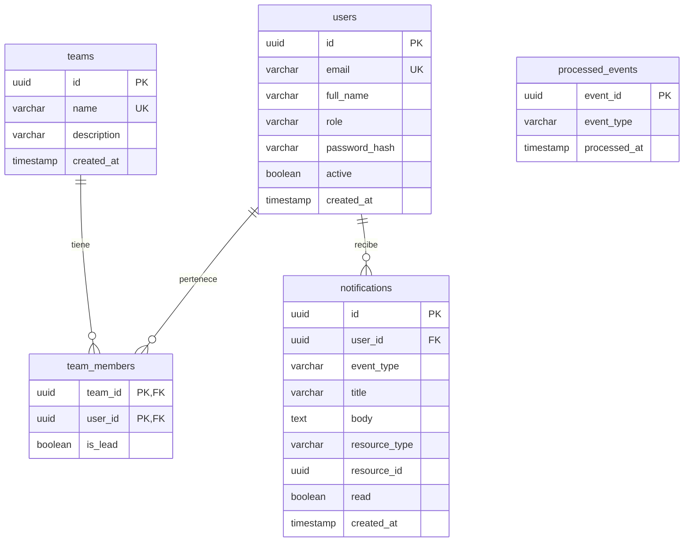

# ms-identity — ServiDesk

Tenants, login y emisión del JWT, usuarios, equipos y bandeja de notificaciones.
Contrato: `docs/API_CONTRACTS.md` §3 (JWT y multi-tenancy) y §8.1 (endpoints).

## Endpoints

| ID | Método y ruta | Roles | Handler |
|---|---|---|---|
| ID-01 | `POST /auth/login` | pública | `login.login` |
| ID-02 | `GET /auth/me` | todos | `login.me` |
| ID-03 | `GET /users` | admin, agent | `users.listUsers` |
| ID-04 | `GET /users/{id}` | admin, agent | `users.getUser` |
| ID-05 | `POST /users` | admin | `users.createUser` (publica `UserCreated`) |
| ID-06 | `PATCH /users/{id}` | admin | `users.updateUser` |
| ID-07 | `GET /teams` | admin, agent | `users.listTeams` |
| — | `GET /notifications?limit=` | todos | `notifications.listNotifications` |
| — | `POST /notifications/read` `{ids?}` | todos | `notifications.markNotificationsRead` |

Respuestas `{data}` / `{data, meta}` y errores `{error: {code, message, details?, request_id}}` según §4.

## Login y JWT

1. `tenant_code` → `public.tenants` (única ruta que resuelve el tenant con un dato del cliente).
2. `email` (en minúsculas) → `<schema>.users`; se verifica `active` y la contraseña.
3. Se firma un JWT HS256 de 1 h con `sub`, `tenant_id`, `schema`, `role`, `iat`, `exp`.
4. Cualquier fallo responde `401 INVALID_CREDENTIALS` con el mismo mensaje (y el mismo costo de
   cómputo: si el tenant o el usuario no existen se verifica contra un hash de relleno).

Contraseñas: PBKDF2-SHA256, 310 000 iteraciones, salt de 16 bytes (decisión D7), formato
`pbkdf2_sha256$<iter>$<salt>$<hash>`. Solo usa `hashlib`, sin binarios en el layer.

El Lambda Authorizer (`infra/authorizer/handler.py`) exige `exp`, `sub`, `tenant_id`, `schema` y `role`,
y rechaza el token si `schema != "tenant_" + tenant_id` o el rol no es válido (§3.3).

## Base de datos (`db_identity`)

- `public.tenants (code PK, schema_name, name, active, created_at)` — `migrations/000_public.sql`
- Por schema `tenant_*` — `migrations/001_init.sql`:
  `users`, `teams`, `team_members`, `notifications`, `processed_events`



### Migración

```bash
npx serverless identity:invoke --function migrate
```

Es idempotente. Crea `public.tenants` con andina, pacifico y unitec, las tablas de cada schema,
los 6 equipos base y 3 cuentas demo por tenant (las mismas del modo demo del frontend):

| Tenant | admin | agent | customer | Contraseña |
|---|---|---|---|---|
| andina | carla.mendoza@andina.pe | lucia.paredes@andina.pe | jorge.huaman@andina.pe | `Andina#2026` |
| pacifico | ricardo.vega@pacifico.pe | ana.quispe@pacifico.pe | marta.salazar@pacifico.pe | `Pacifico#2026` |
| unitec | diego.torres@unitec.edu.pe | sofia.ramos@unitec.edu.pe | pablo.chavez@unitec.edu.pe | `Unitec#2026` |

Los UUID de usuarios y equipos son deterministas (`handlers/tenant_data.py`: `user_id(tenant, email)`,
`team_id(tenant, nombre)`), para que el seed de los otros servicios use los mismos IDs.

## Eventos

- **Publica** `UserCreated` (ID-05).
- **Consume** `identity-notify-q` (SNS → SQS con DLQ, `maxReceiveCount: 3`, `ReportBatchItemFailures`):
  `IncidentCreated`, `IncidentUpdated`, `IncidentResolved`, `ProblemCreated`, `KnownErrorPublished`,
  `ChangeSubmitted`, `ChangeApproved`, `ChangeRejected`, `RequestSubmitted`, `RequestApproved`,
  `RequestRejected`, `RequestFulfilled` → filas en `notifications` (no se notifica al propio actor;
  duplicados descartados con `processed_events`).

## Pruebas

```bash
python -m pytest services/identity/tests -q
```

75 pruebas unitarias (handlers, consumidor, migración y authorizer) con `common.http` real y la base simulada.
Además, el flujo completo (migración ×2, login, filtros, aislamiento entre tenants, alta y edición de
usuarios, consumidor y bandeja) se validó contra PostgreSQL 16 real en Docker.
